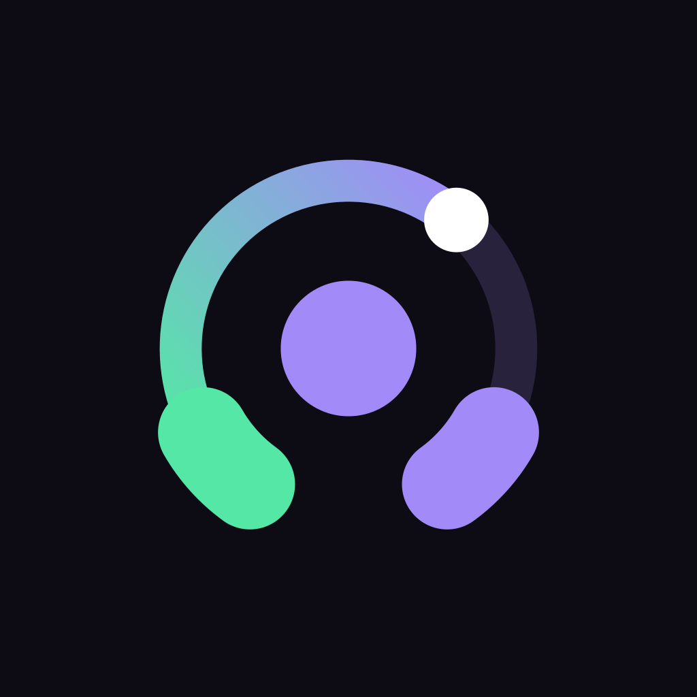
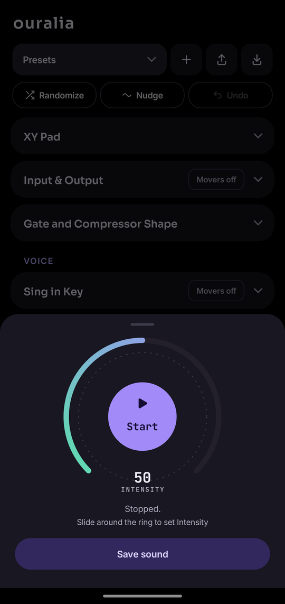
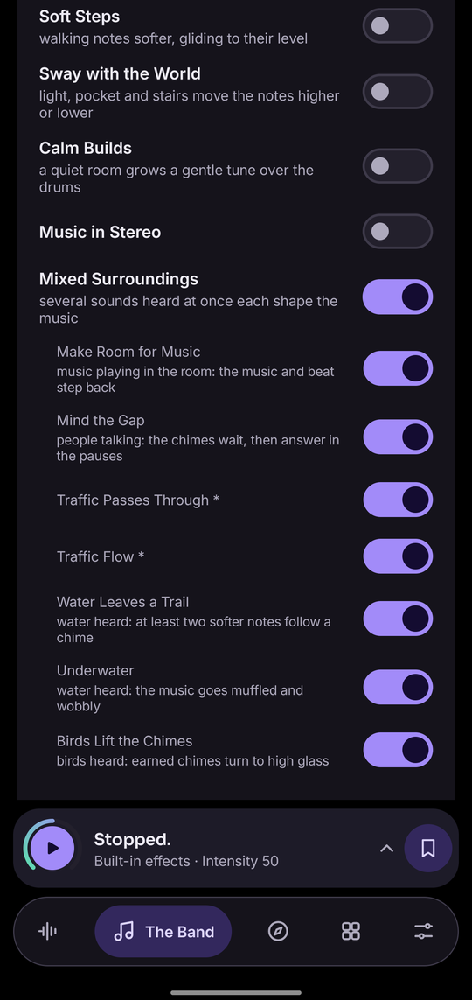
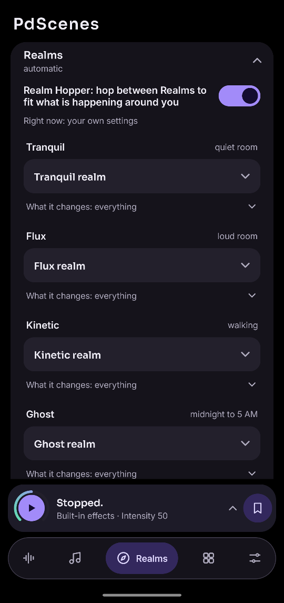

<p align="center"></p>

<h1 align="center">Ouralia</h1>

<p align="center"><b>The world around you, turned into music, through your headphones.</b></p>

Ouralia is a free, open-source Android app in the spirit of **RjDj**, the "reactive music" app from 2008. Put on
headphones and press Start: you hear the room around you, shaped by effects and set to music that the app makes up
as it goes. The music follows how loud the room is, how you move, how bright it is and whether the phone is in your
pocket. Walk and the beat follows your steps. Clap, and the room answers; knock, and the knock becomes the drums. Stay
somewhere quiet a while and a gentle tune joins the beat.

It runs on [Pure Data](https://puredata.info/) inside the app (through [libpd](https://github.com/libpd/libpd)), and
it can also play the original RjDj scenes. It will be free on Google Play. (Its working name was PdScenes.)

<p align="center">

&nbsp;

&nbsp;

</p>

## What it does

- **The world, reshaped.** Echo (with repeats that fly around your head), reverb, glitches that bring back bits of
  what you just heard, pitch, ring modulation, a vocoder, filters, chorus, flanger, phaser and more, all on the
  sound around you.
- **Music that listens.** Chords, a melody, a bass line and a beat, in a key you choose. Sounds in the room ring
  the current chord, a held hum gets an answering note, and a sung phrase gets a reply.
- **Found sounds.** Knocks, taps and clicks the mic catches become the drums on the rhythm grid, and each part of
  the music can play its built-in synth sound, the found sounds, or both.
- **Hearing what kind of sound it is** (test builds for now). The app can tell voices, music, traffic, birds, water
  and steps apart on the phone itself, and answer them: the music makes room for music playing nearby, holds back
  while people talk, lets a passing car sweep a chime from ear to ear, and more, each behind its own switch.
- **Realms** change the whole sound to fit the moment: Tranquil in a quiet room, Flux when it gets loud, Kinetic
  while you walk, Ghost after midnight, Pocket when the phone is put away. **Realm Hopper** moves between them by
  itself, and a soft warp tells you when it does.
- **One dial, Intensity**, turns everything calmer or busier. **Movers** let sliders move by themselves, following
  the room, the phone's tilt or an XY pad.
- **Scenes:** import original RjDj scenes (`.rj` folders or zips). Four official RjDj example scenes are built in.
- **Presets** save a sound to come back to or share.
- **A desktop version** for Linux plays the same music as background for a stream ([desktop/](desktop/README.md)).

## Promises

- **Headphones only.** The app never plays through the phone's speaker (the mic would hear it and howl).
- **The mic never touches the disk.** Nothing you hear is recorded or saved. What the glitches and found sounds
  catch lives in memory for a few seconds.
- **No internet.** The app has no internet permission at all, and no ads, accounts or tracking.

## Status

In beta, tested by a small group. No test build is posted on GitHub right now: the repository was remade on
Nov 2, 2026, and the next release starts fresh. What testers should know is in the [tester guide](docs/TESTER-GUIDE.md).
Made by DadCraft, a hobbyist musician, with AI coding assistants.

## Documents

| | |
|---|---|
| [Tester guide](docs/TESTER-GUIDE.md) | Everything in the app, tab by tab, and what testers should listen for |
| [Desktop stream mode](desktop/README.md) | The Linux version, for streaming |
| [Design notes](docs/DESIGN-NOTES.md) | How every feature works and why: the project's long memory |
| [Roadmap](docs/ROADMAP.md) | Ideas, planned and built |
| [Privacy](PRIVACY.md) | What the app does with the mic and everything else |
| [Contributing](CONTRIBUTING.md) | Reporting a problem, sending a change, the rules the app keeps |
| [Releasing](docs/RELEASING.md) | The steps for a release, the Play key, drafts for the Play forms |
| [RjDj notes](docs/RJDJ-NOTES.md) | The RjDj scene format and what a player must provide |

## Building

You need a JDK 21 and the Android SDK (Android Studio brings both). The phone must run Android 9 or newer.

```
./gradlew assembleDebug
adb install -r app/build/outputs/apk/debug/app-debug.apk
```

`./gradlew assembleDev` builds **Ouralia Dev** (`app/build/outputs/apk/dev/app-dev.apk`), the test build with the
newest features and the sound classifier. It installs beside the normal app, with its own settings.

Everything the build needs is in the repository, including our own build of `pd-core` (libpd for Android, in
`third_party/maven/`, made by `tools/build_pdcore.sh` from our forks of pd-for-android and libpd).

How the code is laid out:

- `app/src/main/java/io/github/dadcraftttv/ouralia/`: the app, in Java with plain Android Views. `Params.java` lists every setting.
- `app/src/main/assets/patches/test_scene.pd`: the built-in Pure Data patch. It's generated: edit
  `tools/patchgen/` and run `tools/make_patch.py`, never the `.pd` file itself.
- `dcs/`: our own Pd objects in C (effects and instruments). After changing them, run `make -C dcs` and
  `tools/build_dcs_android.sh`.
- `app/src/dev/`: the Ouralia Dev build's extras: the on-device sound classifier (YAMNet) and its notice.
- `desktop/`: the Linux stream mode, which compiles the phone's own logic.

**Tests:** `tools/run_tests.sh` runs everything: the patch through a desktop libpd (`tools/build_libpd.sh` builds
it), our C objects, the Java logic and the desktop app. `tools/run_tests.sh quick <words>` runs only the parts
whose titles match.

## Licence

GPLv3 or later (see [LICENSE](LICENSE)). The app bundles RjDj's library of Pd abstractions (`rjlib`, GPLv3) and
the four RjDj example scenes. Our own Pd objects in `dcs/` are BSD-3-Clause. Every third-party component and its
licence is listed in [NOTICE.md](NOTICE.md) and shown in the app under *About and licenses*.

With thanks to RjDj (Reality Jockey Ltd.), Miller Puckette and the Pure Data community, the libpd team, and Dan
Wilcox's PdParty.
